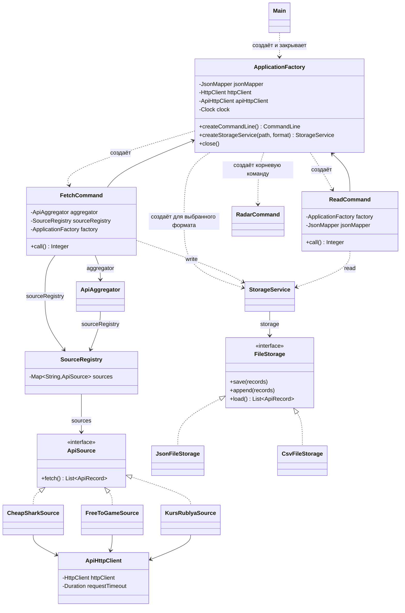

# Halyava Radar

Консольное приложение на Java 21, которое собирает игровые предложения и другие данные из внешних API и сохраняет их в JSON или CSV. Сохранённые записи можно читать без обращения к API и фильтровать по источнику.

## Источники

| Имя для CLI | API | Что получаем сейчас |
|---|---|---|
| `cheapshark` | [CheapShark](https://www.cheapshark.com/api/1.0/deals) | Скидки GOG до $10 и бесплатные предложения; до двух предложений в каждой выборке |
| `freetogame` | [FreeToGame](https://www.freetogame.com/api/games) | Два последних по дате выхода бесплатных PC-шутера |
| `kursrublya` | [Курс рубля](https://kurs-rublya.ru/api/v1/rates/USD/series/?limit=3) | История USD/RUB: до трёх точек в одной записи |

Параметры запросов заданы в `ApplicationFactory`. Источники опрашиваются последовательно; при сбое одного сбор остальных продолжается, причина попадает в лог.

## Запуск

Нужен JDK 21. Команды выполняются из корня проекта; Gradle запускается через wrapper (`gradlew.bat` в Windows).

```bash
# Справка: без аргументов — общая, с именем команды — подробная
./gradlew run
./gradlew run --args="fetch --help"
./gradlew run --args="read --help"

# Все источники → JSON; файл будет перезаписан
./gradlew run --args="fetch --path data/records.json"

# Выбранные источники → CSV
./gradlew run --args="fetch --sources cheapshark,freetogame --format csv --path data/records.csv"

# Добавить записи к уже сохранённым
./gradlew run --args="fetch --sources kursrublya --mode append --path data/records.json"

# Читать файл целиком или отфильтровать записи
./gradlew run --args="read --path data/records.json"
./gradlew run --args="read --format csv --path data/records.csv --source cheapshark"

# Тесты и сборка дистрибутива со скриптами запуска и зависимостями
./gradlew test
./gradlew installDist
./build/install/halyava-radar/bin/halyava-radar --help
```

По умолчанию: все источники, формат `json`, режим `overwrite`. Параметр `--path` обязателен; `append` добавляет записи без удаления дубликатов, в CSV заголовок остаётся один. Значения формата и режима можно писать в любом регистре.

## Данные и вывод

`read` выводит JSON независимо от формата входного файла. Ниже условная запись с сокращённым содержимым `data`; так же выглядит элемент массива в сохранённом JSON:

```json
[
  {
    "source": "cheapshark",
    "title": "Example Game",
    "url": "https://www.cheapshark.com/redirect?dealID=example",
    "fetchedAt": "2026-11-19T12:00:00Z",
    "data": { "salePrice": 1.99, "currency": "USD", "type": "DISCOUNT" }
  }
]
```

Та же запись в CSV: поля `ApiRecord` становятся колонками, а `data` хранится как JSON внутри одной ячейки. Кавычки внутри CSV-ячейки удваиваются.

```csv
"source","title","url","fetchedAt","data"
"cheapshark","Example Game","https://www.cheapshark.com/redirect?dealID=example","2026-11-19T12:00:00Z","{""salePrice"":1.99,""currency"":""USD"",""type"":""DISCOUNT""}"
```

Служебные сообщения идут в stderr, логи уровня INFO и выше — также в `logs/halyava-radar.log`. Каталоги `data/` и `logs/` исключены из Git. Коды завершения: `0` — успех, `1` — ошибка выполнения, `2` — ошибка аргументов; сбои отдельных API обрабатываются внутри агрегатора и сами по себе не меняют код завершения.

## Как связаны классы

Основные зависимости показаны стрелками, создание объектов — пунктиром. Поля параметров CLI и детали отдельных API опущены, чтобы схема оставалась компактной.



У каждого источника есть общий `ApiHttpClient`, свой mapper, общий `JsonMapper`, адреса запросов и `Clock`. Источники создают `ApiRecord(source, title, url, fetchedAt, data)`, агрегатор объединяет записи; оба хранилища содержат `Path filePath` и общий `JsonMapper`. Фабрика создаёт только выбранную реализацию хранилища, а `Main` закрывает её HTTP-клиент после выполнения команды.
